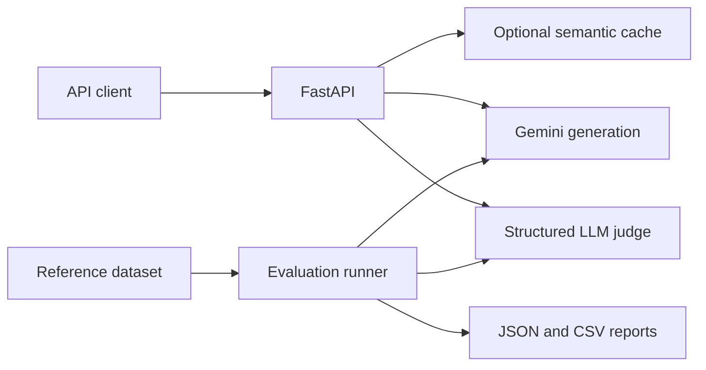

# Evalora

### LLM Evaluation & Optimization Engine

Evalora is a local Python toolkit for generating answers with Gemini, evaluating their quality against reference answers, and reusing responses through semantic caching. It pairs a FastAPI backend with a repeatable evaluation runner so experiments can be compared using scores, latency, token usage, and failure counts.

**Status:** Initial backend milestone complete. Generation, structured judging, semantic caching, and batch evaluation are implemented. A local Streamlit results dashboard is implemented.

## Features

- **Gemini generation:** configurable model, request timeout, input validation, and sanitized provider errors.
- **LLM-as-a-Judge:** correctness, relevance, and clarity scores from 1–5, with reasoning and an optional reference answer.
- **Optional caching:** exact matching by default, with explicitly configured guarded semantic reuse, model separation, expiry, and bounded in-memory storage.
- **Repeatable experiments:** evaluate a dataset across generation models with a fixed judge; export detailed JSON and CSV metrics.
- **Secret-safe configuration:** `.env` settings stay local; API keys and raw provider exceptions are excluded from responses and reports.

## Architecture



## Quick start

Use Python 3.11 or later and a Gemini API key with access to the configured models.

```sh
git clone https://github.com/vedantdubey19/Evalora.git
cd Evalora
python -m venv .venv
source .venv/bin/activate
python -m pip install -r requirements.txt
cp .env.example .env
```

Edit `.env` locally:

```dotenv
GEMINI_API_KEY=your_actual_api_key
GEMINI_MODEL=gemini-2.5-flash
GEMINI_JUDGE_MODEL=gemini-2.5-flash
```

The model must be available to your API key. Never commit `.env` or paste the key into issues, screenshots, or chat. `.env` is loaded from the project root; existing environment variables take precedence.

On the existing development Mac, continue using the working environment instead of reinstalling:

```sh
cd ~/Developer/AI-Projects/Evalora
conda activate evalora-fixed
```

Keep the working pip-based ML installation intact; avoid mixing Conda PyTorch/FAISS builds into it. `requirements.txt` lists direct dependencies and is not a full environment lockfile.

Start the API:

```sh
python -m uvicorn app.main:app --host 127.0.0.1 --port 8000 --reload
```

Open the [interactive API documentation](http://127.0.0.1:8000/docs).

## API examples

### Generate an answer

```sh
curl -X POST http://127.0.0.1:8000/generate \
  -H 'Content-Type: application/json' \
  -d '{"question":"What is machine learning?","use_cache":false}'
```

The response contains the question, model, answer, generation latency in milliseconds, token usage, cache status, and similarity when a cached answer is reused.

### Evaluate an answer

```sh
curl -X POST http://127.0.0.1:8000/evaluate \
  -H 'Content-Type: application/json' \
  -d '{"question":"What is 2 + 2?","answer":"4","reference":"4"}'
```

The judge returns correctness, relevance, and clarity scores, their mean (`overall`), reasoning, and the judge model. `reference` is optional for the API; reference answers are required in experiment datasets.

| Endpoint | Purpose |
| --- | --- |
| `GET /` | API welcome response |
| `GET /health` | Process health and whether a nonempty API key is configured |
| `POST /generate` | Generate or reuse an answer |
| `POST /evaluate` | Score a supplied answer |

Invalid inputs return `422`, missing API configuration returns `503`, and provider failures return sanitized `502` responses. Health checks do not verify live provider access.

## Run evaluations

```sh
python -m experiments.run_eval
```

The included three-case dataset has six provider stages: one generation and one judging stage per case. Bounded retries can add calls; pass `--max-retries 0` to disable them. For a smaller smoke test:

```sh
python -m experiments.run_eval --limit 1
```

Compare models accessible to your account while keeping the judge fixed:

```sh
python -m experiments.run_eval --models MODEL_ID_1 MODEL_ID_2
```

Supply your own dataset with `--dataset path/to/cases.json`:

```json
[
  {
    "id": "arithmetic",
    "question": "What is 17 multiplied by 6?",
    "reference": "102"
  }
]
```

Datasets accept 1–100 cases with unique IDs. Reports are saved as timestamped JSON and CSV files under `results/`, which is excluded from Git. JSON includes prompts, reference answers, generated answers, and judge reasoning; avoid private data when sharing reports.

Each summary includes completed evaluations, failures, mean judge score, generation latency, and generation token totals. Failed cases are recorded and the run continues. Exit codes: `0` for a complete successful run, `1` for case failures, and `2` for invalid dataset or CLI configuration. Caching is disabled during benchmarks.

## Day 2: compare models and measure cache accuracy

The Day 2 dataset contains 24 public cases, six each for reasoning, factual answers, coding, and instruction following. The cache dataset has 12 reusable pairs and 12 different-answer pairs, including changed numbers, entities, negation, and directions.

```sh
GEMINI_JUDGE_MODEL=gemini-3.1-flash-lite python -m experiments.run_eval \
  --dataset experiments/day2_cases.json \
  --models gemini-2.5-flash gemini-3.1-flash-lite \
  --request-interval 4 --model-interval gemini-2.5-flash=13
python -m experiments.run_cache_eval
```

If a run ends with provider failures, use the same command with `--resume results/EXACT_REPORT_FILENAME.json` after quota becomes available. Only successful, validated rows from the same dataset fingerprint, judge, and temperature are reused; failures are retried. The new report records reuse counts and the earlier report time. Resuming combines observations from different times and is not a fresh independent run.

The 24-case, two-model comparison has 96 provider stages. With the default two additional retries per stage, its theoretical maximum is 288 provider invocations; quota and outage safeguards often stop it earlier. Listed models may still be unavailable for generation; verify access before starting a large run. Request intervals are configurable examples, not guaranteed account quota limits. Known daily quotas and unavailable models are not retried. Temporary server, network and timeout failures can use the bounded retry budget; exhausted failures stop further calls to that model. Unknown 429 limits stop immediately unless the server supplies a short retry delay. If the judge is blocked, remaining cases are skipped without generation calls. Resume later when access recovers. Provider errors use safe reason labels; raw exceptions are never saved.

Benchmark generation and judging use temperature zero. Reports record the dataset SHA-256, judge model, request intervals, and generation temperature. Zero temperature reduces variation but does not guarantee deterministic output. Generation latency excludes request pacing and judging; generation token totals exclude judge usage and are not cost estimates. Earlier Day 1 reports did not record temperature or dataset hashes and should not be treated as identical experiments.

The dashboard adds category filters and category scores under **Model evaluations**, plus a **Cache accuracy** view with precision, recall, false-positive rates, and per-pair mismatches. Cache experiments use real embeddings without LLM API calls; the first use may download public model weights. Each pair starts with a fresh cache containing only its source question, so these results do not test nearest-neighbor behavior in a large corpus.

Cache rates exclude embedding errors. Undefined rates are reported as missing, rather than zero. These small datasets are development checks, not a representative benchmark or a guarantee of safe reuse. Use held-out pairs before tuning thresholds. See `docs/day2-results.md` for the measured results and limitations.

## Cache safety — Day 3

Caching is still disabled unless a request sets `use_cache` to `true`. When enabled, the new default is `CACHE_MATCH_MODE=exact`: only identical questions for the same model reuse an answer. API input validation strips outer whitespace; case, punctuation, and internal whitespace otherwise remain significant. Exact matching does not load or download an embedding model.

To explicitly enable conservative semantic matching, add this to your local `.env` and restart the API:

```dotenv
CACHE_MATCH_MODE=guarded
```

Guarded matching requires both a matching ordered content signature and cosine similarity at or above `CACHE_SIMILARITY_THRESHOLD` (default 0.95). The signature retains all words, punctuation and symbols, including Unicode comparisons, currency signs, quoted text, letter case, and token order. It preserves question types and modal verbs. Its only explicit wording rewrite is lowercase “capital city” to “capital”; multiline nonexact requests are rejected to protect indentation-sensitive code. It rejects the observed negation, direction, sort-order and comparison-operator changes. Compatible candidates are filtered before nearest-neighbor selection. This is a deliberately restrictive lexical heuristic, not a semantic-equivalence proof; it misses many valid paraphrases and may still miss untested meaning differences. Use exact mode when uncertain.

The API reports `cache_match_mode` alongside `cache_status`. The unguarded `cosine` matcher remains available only to the experiment runner as a baseline; application settings accept only `exact` and `guarded`.

All modes retain the 600-second TTL, 256-entry FIFO capacity, model separation, and process-local storage. Restarting clears cached answers. Guarded mode lazily loads the configured sentence-transformer model and falls back to normal generation if embeddings fail. Cached responses have no new provider token usage. A matching question can still need a fresh answer when facts, context, or permissions change; keep caching off for such requests. This remains a localhost, single-user prototype.

Compare policies without Gemini API calls:

```sh
python -m experiments.run_cache_eval --policies cosine guarded exact
python -m experiments.run_cache_eval \
  --dataset experiments/cache_challenge_pairs.json \
  --policies cosine guarded exact
```

Each dataset has 24 labeled pairs and is evaluated at five thresholds with all three policies. The exact policy ignores thresholds; its repeated threshold rows keep the comparison table aligned. New reports include policy names and decisions such as exact hit, guard veto, and below-threshold miss. Historical cache reports without policy fields load as the original cosine baseline. The dashboard lets you select a policy and inspect mismatches, defaulting to exact when available.

See [Day 3 measured results](docs/day3-results.md) for false-hit counts, missed-reuse trade-offs, reproducible commands and limitations. The challenge set is separately authored, not an independent production sample. The guard was strengthened after code-review regressions and both datasets were rerun; treat them as development sets, not blinded held-out validation. The 0.95 threshold was not retuned.

## Reliable evaluation runs — Day 4

Each CLI run writes one uniquely named `eval-*.json` checkpoint under `results/` before provider construction, after every processed case, and when the run finishes or is cancelled. JSON is written to a temporary file, flushed, and atomically replaced. Readers see the previous valid snapshot or the new one. A checkpoint write failure stops further calls; an older saved snapshot remains available. CSV is exported on normal completion.

```sh
python -m experiments.run_eval --max-retries 2 --max-retry-delay 30
# After cancellation or provider recovery, rerun the same dataset/models/judge with:
python -m experiments.run_eval --resume results/EXACT_CHECKPOINT_FILENAME.json
```

Keep the dataset and judge settings identical when resuming. The saved JSON remains resumable even with `pending`, `skipped`, or `interrupted` rows; only validated fully evaluated cases are reused. A partially generated but unevaluated case is saved for inspection and will be generated again on resume. Resume creates a new report and preserves the original.

Retry behavior applies to the experiment runner, not the `/generate` endpoint. Default: two additional attempts per generation or judge stage, with exponential backoff and jitter. `--max-retries` accepts 0–3; `--max-retry-delay` accepts 0–60 seconds. Server retry delays are honored when within this cap; longer waits stop that model instead of retrying early. Google daily quota metadata is recognized explicitly and never retried in the run. Generic or ambiguous 429 errors are not assumed transient. Retry delays and request pacing are excluded from provider latency, while time spent in failed provider attempts is included.

New reports distinguish `ok`, `pending`, `skipped`, attempted stage failures, and `interrupted`. They record stage invocation counts and retries for the current run. Reused samples have zero new attempts; their answer latency and generation token observations remain historical values. These counters are not billing totals, and generation token metrics exclude judge usage and may include reused answers.

The dashboard shows processed progress, run state, pending/skipped/reused counts, and safe provider-failure reasons. A run marked `finished` means processing ended; it does not mean every case passed. A running checkpoint can also belong to a process that stopped unexpectedly. Historical reports retain their original accounting and may combine skips with errors; missing attempt counts remain unknown.

Atomic checkpoints protect completed writes from ordinary process interruption; they do not make a provider request transactional or guarantee recovery from storage hardware failure. Cancelling during a request may still incur provider usage, and an uncheckpointed in-flight case may need to run again.

See [Day 4 validation](docs/day4-reliability.md) for the failure scenarios tested without Gemini API calls.

## Evaluation quality — Day 5

The original three-score rubric remains the default (`legacy-v1`) for compatibility. Opt into `quality-v2` for correctness, instruction following, relevance, completeness, and clarity. The weighted overall score uses 35%, 25%, 15%, 15%, and 10% respectively. These are versioned project-policy choices, not statistically calibrated weights.

```sh
python -m experiments.run_eval --dataset experiments/quality_cases.json --rubric quality-v2
```

The quality dataset includes output requirements. Those datasets are rejected in legacy mode so constraints cannot be silently ignored. The four-case example has eight provider stages before retries; it requires API access. No live quality benchmark was run during this milestone.

### Check output requirements without an API key

```sh
curl -X POST http://127.0.0.1:8000/check \
  -H 'Content-Type: application/json' \
  -d '{"answer":" READY\n","checks":{"expected_exact":"READY","trim_outer_whitespace":false}}'
```

`POST /check` performs deterministic checks only. Supported requirements are case-sensitive expected text, an optional whitespace-separated word limit, valid JSON, and an exact set of top-level JSON object keys. Exact text comparison trims outer whitespace by default; set `trim_outer_whitespace` to false when formatting must be strict. Answer text is preserved on these new routes. JSON checks reject Markdown fences, duplicate object keys and nonstandard NaN/Infinity constants. They do not execute generated code or verify factual claims. When no checks are supplied, `checks_passed` is null, not true.

### Judge answer quality

`POST /evaluate/quality` accepts question, answer, optional reference, and the same checks object. It always uses quality-v2. `POST /evaluate` retains the configured rubric, defaulting to legacy-v1. `EVALUATION_RUBRIC` or the CLI `--rubric` option selects the benchmark rubric.

Quality results include five ratings, a weighted overall score, reasoning, limitations, rubric metadata, and separate deterministic-check outcomes. A failed output requirement does not secretly rewrite the judge score; inspect both. Scores without a reference are labeled `unverified_judgment`, and scores with one remain model opinions based on the supplied reference, not independently verified facts.

Reports record their rubric version. Resumption rejects a changed rubric or changed requirements and recomputes saved deterministic results before reuse. Cases without requirements retain their historical dataset fingerprints. The dashboard shows extra dimensions, requested requirements and check results. Mixed-rubric selections do not receive an aggregate mean or combined score chart.

See [Day 5 quality validation](docs/day5-quality.md). The offline examples test mechanics and format constraints; they do not establish LLM-judge reliability.

## Run evaluations from the dashboard — Day 6

Start the dashboard once, then select **Run evaluation** in the sidebar:

```sh
python -m streamlit run dashboard/app.py --server.address 127.0.0.1
```

Choose the sample or quality dataset, or upload UTF-8 JSON (up to 2 MB, 1–100 cases). Invalid fields are reported by row without displaying the whole uploaded record. Preview the first five questions, choose a question count, enter up to four unique generation model IDs, choose a judge and rubric, and set the retry budget and request interval.

The page shows a maximum provider-stage attempt count before starting. This includes configured retries and excludes validated reused evaluations; it is not a monetary estimate. Model availability is checked only when the provider receives a request. Opening or refreshing the page does not make model calls. Press **Start evaluation (uses Gemini)** to authorize the run.

One worker can run per dashboard process, shared across its tabs. Progress refreshes every two seconds while the page is active. Cancel interrupts pacing and retry waits promptly; an in-flight provider request must return or reach its configured timeout first. No further stage is started once cancellation is observed. Completed checkpoints remain downloadable, and CSV becomes available after normal completion.

For **Resume saved run**, select a JSON report from the results folder. Dataset, models, judge, rubric, and pacing settings are reconstructed and validated before launch. Only fully evaluated cases are reused. A checkpoint marked running requires you to confirm that the original process has stopped; another CLI or dashboard process is not coordinated by this worker manager.

A run continues if the tab closes. Restarting the dashboard process stops its daemon worker; its latest atomic checkpoint remains available for resumption. This is a single-user localhost workflow, without authentication, cross-process locking, or cloud job persistence. API keys stay in `.env` and never enter job status, downloads, or error labels.

See [Day 6 workflow validation](docs/day6-dashboard-runs.md). All workflow tests used fake providers; no Gemini calls were made during development.

## Project structure

```text
app/
  main.py                  FastAPI endpoints
  core/config.py           Environment configuration
  services/
    llm_client.py          Gemini SDK integration
    evaluation.py          Structured judge and score validation
    cache.py               Sentence embeddings and semantic cache
    benchmark.py           Dataset validation and evaluation runs
experiments/
  run_eval.py              Experiment command-line entry point
  sample_cases.json        Public sample evaluation dataset
dashboard/                 Read-only model comparison and cache accuracy views
tests/                     Offline tests with fake provider responses
.env.example               Configuration template, without secrets
requirements.txt           Direct Python dependencies
```

## Tests and verification

```sh
python -m pytest -q
```

The current backend has **140 passing offline tests**. Tests cover input validation, SDK parameters, error sanitization, structured judging, cache bypass and matching, expiry, model separation, embedding failure fallback, and experiment reporting. They require no API key, model download, or paid calls.

Live development checks have also verified Gemini generation and judging, a complete three-case experiment, and exact and paraphrased cache hits. These are smoke checks, not general quality benchmarks.

## Results dashboard

```sh
python -m streamlit run dashboard/app.py --server.address 127.0.0.1
```

Open [the local dashboard](http://127.0.0.1:8501). Select saved runs and models in the sidebar to compare quality, latency, generation tokens, and failures. Inspect individual questions, reference answers, generated answers, and judge reasoning. Download a comparison CSV for the current selection, and use Refresh reports after another experiment completes.

The Model evaluations and Cache accuracy views read saved reports only. The Run evaluation view loads the local configuration privately and starts provider calls only after you explicitly press Start. Invalid reports are skipped with a warning. It handles empty results and failed evaluations, and warns when selected runs use different judges or datasets. Times in filenames and report metadata are UTC. Keep it bound to localhost because reports may contain private prompts and answers.

## CodeRabbit reviews

The repository includes `.coderabbit.yaml` with project-specific review guidance. Automatic pull request reviews require the CodeRabbit GitHub app to be installed and enabled for this repository. Configuration alone does not install the app.

For local reviews after installing and authenticating the CodeRabbit CLI:

```sh
coderabbit auth login --agent
coderabbit review --agent -t uncommitted -c .coderabbit.yaml
```

## Limitations and next steps

This is a single-user local prototype. Keep the API bound to localhost; authentication, tenant isolation, and request rate limits are required before shared deployment. Multiple workers maintain independent caches, and restarting clears cached answers.

Similar wording can hide different meanings, especially numbers and negation. Disable caching for sensitive, dynamic, or precision-critical questions. Judge scores are model opinions; calibrate with trusted references and human review. Using the same model as generator and judge can introduce bias. The included dataset is too small to rank models reliably.

Token totals cover generation only, including provider-reported thinking tokens, and are not monetary cost estimates. API access and billing are separate from consumer chat subscriptions.

Next milestones: independently reviewed datasets, context-aware cache keys, calibrated judging, and completion of the separate Gemini model comparison when service access recovers.

## References

- [Google Gen AI Python SDK](https://googleapis.github.io/python-genai/)
- [FastAPI documentation](https://fastapi.tiangolo.com/)
- [Sentence Transformers documentation](https://www.sbert.net/)
- [CodeRabbit configuration](https://docs.coderabbit.ai/reference/configuration)
