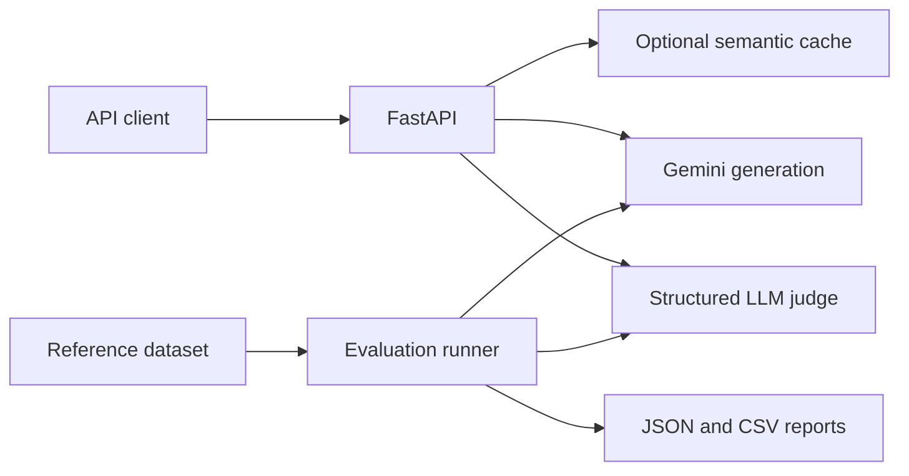

# Evalora

### LLM Evaluation & Optimization Engine

Evalora is a local Python toolkit for generating answers with Gemini, evaluating their quality against reference answers, and reusing responses through semantic caching. It pairs a FastAPI backend with a repeatable evaluation runner so experiments can be compared using scores, latency, token usage, and failure counts.

**Status:** Initial backend milestone complete. Generation, structured judging, semantic caching, and batch evaluation are implemented. A results dashboard is planned.

## Features

- **Gemini generation:** configurable model, request timeout, input validation, and sanitized provider errors.
- **LLM-as-a-Judge:** correctness, relevance, and clarity scores from 1–5, with reasoning and an optional reference answer.
- **Semantic caching:** optional reuse of similar questions using sentence embeddings and cosine similarity, with model separation, expiry, and a bounded in-memory store.
- **Repeatable experiments:** evaluate a dataset across generation models with a fixed judge; export detailed JSON and CSV metrics.
- **Secret-safe configuration:** `.env` settings stay local; API keys and raw provider exceptions are excluded from responses and reports.

## Architecture



## Quick start

Use Python 3.11 or later and a Gemini API key with access to the configured models.

```sh
git clone https://github.com/vedantdubey19/Evalora.git
cd Evalora
python -m venv .venv
source .venv/bin/activate
python -m pip install -r requirements.txt
cp .env.example .env
```

Edit `.env` locally:

```dotenv
GEMINI_API_KEY=your_actual_api_key
GEMINI_MODEL=gemini-2.5-flash
GEMINI_JUDGE_MODEL=gemini-2.5-flash
```

The model must be available to your API key. Never commit `.env` or paste the key into issues, screenshots, or chat. `.env` is loaded from the project root; existing environment variables take precedence.

On the existing development Mac, continue using the working environment instead of reinstalling:

```sh
cd ~/Developer/AI-Projects/Evalora
conda activate evalora-fixed
```

Keep the working pip-based ML installation intact; avoid mixing Conda PyTorch/FAISS builds into it. `requirements.txt` lists direct dependencies and is not a full environment lockfile.

Start the API:

```sh
python -m uvicorn app.main:app --host 127.0.0.1 --port 8000 --reload
```

Open the [interactive API documentation](http://127.0.0.1:8000/docs).

## API examples

### Generate an answer

```sh
curl -X POST http://127.0.0.1:8000/generate \
  -H 'Content-Type: application/json' \
  -d '{"question":"What is machine learning?","use_cache":false}'
```

The response contains the question, model, answer, generation latency in milliseconds, token usage, cache status, and similarity when a cached answer is reused.

### Evaluate an answer

```sh
curl -X POST http://127.0.0.1:8000/evaluate \
  -H 'Content-Type: application/json' \
  -d '{"question":"What is 2 + 2?","answer":"4","reference":"4"}'
```

The judge returns correctness, relevance, and clarity scores, their mean (`overall`), reasoning, and the judge model. `reference` is optional for the API; reference answers are required in experiment datasets.

| Endpoint | Purpose |
| --- | --- |
| `GET /` | API welcome response |
| `GET /health` | Process health and whether a nonempty API key is configured |
| `POST /generate` | Generate or reuse an answer |
| `POST /evaluate` | Score a supplied answer |

Invalid inputs return `422`, missing API configuration returns `503`, and provider failures return sanitized `502` responses. Health checks do not verify live provider access.

## Run evaluations

```sh
python -m experiments.run_eval
```

The included three-case dataset makes up to six provider calls: one generation and one judging call per case. For a smaller smoke test:

```sh
python -m experiments.run_eval --limit 1
```

Compare models accessible to your account while keeping the judge fixed:

```sh
python -m experiments.run_eval --models MODEL_ID_1 MODEL_ID_2
```

Supply your own dataset with `--dataset path/to/cases.json`:

```json
[
  {
    "id": "arithmetic",
    "question": "What is 17 multiplied by 6?",
    "reference": "102"
  }
]
```

Datasets accept 1–100 cases with unique IDs. Reports are saved as timestamped JSON and CSV files under `results/`, which is excluded from Git. JSON includes prompts, reference answers, generated answers, and judge reasoning; avoid private data when sharing reports.

Each summary includes completed evaluations, failures, mean judge score, generation latency, and generation token totals. Failed cases are recorded and the run continues. Exit codes: `0` for a complete successful run, `1` for case failures, and `2` for invalid dataset or CLI configuration. Caching is disabled during benchmarks.

## Semantic cache

Set `use_cache` to `true` on `/generate` to opt in. The first successful opted-in request loads `sentence-transformers/all-MiniLM-L6-v2`, downloading public model weights if necessary.

| Setting | Default |
| --- | --- |
| Similarity threshold | `0.95` |
| Entry lifetime | `600` seconds |
| Maximum entries | `256` |
| Matching | Cosine similarity on normalized embeddings |
| Storage | Process-local memory, FIFO eviction |

Exact matches bypass embedding lookup. Semantic matches must meet the configured threshold and use the same generation model. Embedding failures fall back to normal generation with `cache_status: unavailable`. Cached responses have no new provider token usage. This small cache uses NumPy search; FAISS is not required at this scale.

## Project structure

```text
app/
  main.py                  FastAPI endpoints
  core/config.py           Environment configuration
  services/
    llm_client.py          Gemini SDK integration
    evaluation.py          Structured judge and score validation
    cache.py               Sentence embeddings and semantic cache
    benchmark.py           Dataset validation and evaluation runs
experiments/
  run_eval.py              Experiment command-line entry point
  sample_cases.json        Public sample evaluation dataset
tests/                     Offline tests with fake provider responses
.env.example               Configuration template, without secrets
requirements.txt           Direct Python dependencies
```

## Tests and verification

```sh
python -m pytest -q
```

The current backend has **13 passing offline tests**. Tests cover input validation, SDK parameters, error sanitization, structured judging, cache bypass and matching, expiry, model separation, embedding failure fallback, and experiment reporting. They require no API key, model download, or paid calls.

Live development checks have also verified Gemini generation and judging, a complete three-case experiment, and exact and paraphrased cache hits. These are smoke checks, not general quality benchmarks.

## CodeRabbit reviews

The repository includes `.coderabbit.yaml` with project-specific review guidance. Automatic pull request reviews require the CodeRabbit GitHub app to be installed and enabled for this repository. Configuration alone does not install the app.

For local reviews after installing and authenticating the CodeRabbit CLI:

```sh
coderabbit auth login --agent
coderabbit review --agent -t uncommitted -c .coderabbit.yaml
```

## Limitations and next steps

This is a single-user local prototype. Keep the API bound to localhost; authentication, tenant isolation, and request rate limits are required before shared deployment. Multiple workers maintain independent caches, and restarting clears cached answers.

Similar wording can hide different meanings, especially numbers and negation. Disable caching for sensitive, dynamic, or precision-critical questions. Judge scores are model opinions; calibrate with trusted references and human review. Using the same model as generator and judge can introduce bias. The included dataset is too small to rank models reliably.

Token totals cover generation only, including provider-reported thinking tokens, and are not monetary cost estimates. API access and billing are separate from consumer chat subscriptions.

Next milestones: a Streamlit results dashboard, broader evaluation datasets, and cache quality measurements on positive and negative question pairs.

## References

- [Google Gen AI Python SDK](https://googleapis.github.io/python-genai/)
- [FastAPI documentation](https://fastapi.tiangolo.com/)
- [Sentence Transformers documentation](https://www.sbert.net/)
- [CodeRabbit configuration](https://docs.coderabbit.ai/reference/configuration)
